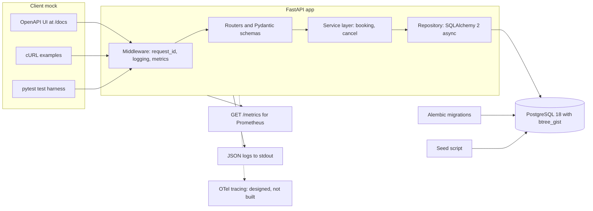
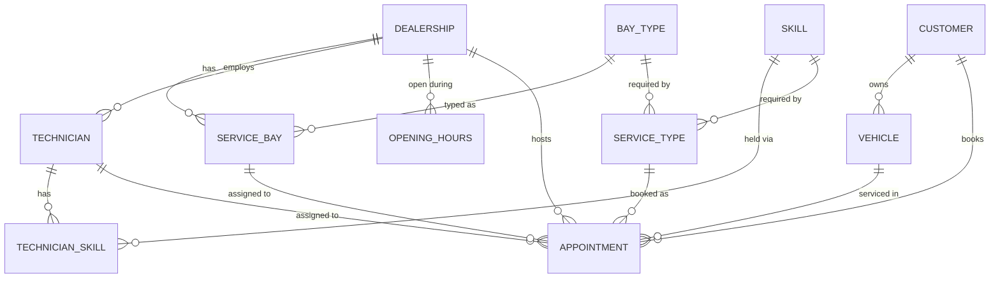
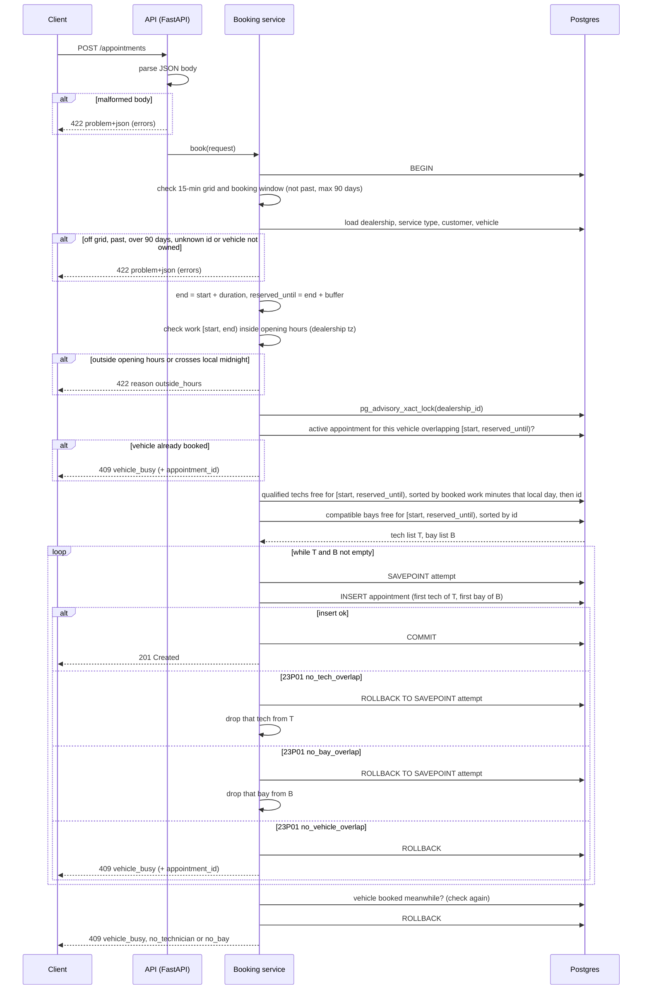

# Unified Service Scheduler: System Design

Status: draft, 2026-11-01. Scenario A (backend implemented, client mocked).

## Key Decisions

- One FastAPI service + one PostgreSQL 18 database; the client is mocked (OpenAPI UI, cURL, tests).
- Double-booking is impossible: three Postgres `EXCLUDE` constraints reject any overlap for the same bay, technician or vehicle, even with many API servers.
- Bookings for one dealership run one at a time, under a Postgres advisory lock. Without it, two parallel inserts can deadlock; the concurrency test found this.
- The system picks the bay and technician: least-loaded qualified tech, lowest-id bay.
- A booking reserves planned work time + a 15-min buffer; overruns are handled by the advisor.
- A vehicle cannot be in two bookings at once, so a resent request gets 409, not a second booking. Cancel frees the slot.
- Kept small on purpose: idempotency keys, an availability query and technician shifts are designed in Future Work, not built.
- Observability: JSON logs with `request_id`, Prometheus `/metrics`, `/health` and `/ready`.

## Overview

Service advisors at a dealership book workshop appointments by hand today. This service replaces that with an API. A client asks for a vehicle, a service type, a dealership and a start time. The service checks that a compatible service bay and a qualified technician are both free for the whole service duration. If both are free, it stores a confirmed appointment that links the customer, vehicle, technician and bay.

The brief's three core requirements map to the design like this:

| Brief requirement | Where it is handled |
|---|---|
| 1. Resource constrained booking | `POST /appointments` with vehicle, service type, dealership and start time |
| 2. Real-time availability check for bay and technician over the whole duration | Booking service picks a candidate pair; three Postgres exclusion constraints (bay, technician, vehicle) reject any overlap at insert time |
| 3. Confirmed appointment record | `appointment` table row linking customer, vehicle, technician and service bay |

Scope:

- Implemented: the backend. A REST API (FastAPI) on PostgreSQL, with booking, cancel, opening hours, health checks and metrics.
- Mocked: the client. The generated OpenAPI UI at `/docs`, cURL examples in the README, and the automated test harness stand in for a front end.
- Reference data (dealerships, bays, technicians, service types, customers, vehicles) is seeded, not managed through the API.

## Assumptions

The brief leaves many rules open. There are 26 numbered assumptions; the full list is in [details/assumptions.md](details/assumptions.md). "Assumption N" in this document refers to that list. The ones that shape the design most:

- The system picks the bay and technician; the client does not (2, 3, 5).
- Duration is a planned standard labour time plus a 15-minute buffer. Overruns are handled by the service advisor, not by the system (9, 24, 25).
- Start times sit on a 15-minute UTC grid, at most 90 days ahead (8, 14).
- Opening hours are one weekly window per day, and technicians work those hours; lunch breaks are not modelled (12, 13).
- A conflict with other bookings returns 409; bad input, including a start outside opening hours, returns 422 (17, 22).
- A vehicle cannot be in two active appointments at once. A resent request gets 409 `vehicle_busy`, not a second booking (18, 19).
- No authentication in this service; an API gateway handles it (23).

## Architecture



| Component | Role |
|---|---|
| Client mock | The OpenAPI UI at `/docs`, cURL examples in the README and the pytest harness. They send the same HTTP requests a front end would. |
| Middleware | Reads or creates the `request_id`, writes one JSON log line per request, and records HTTP metrics. |
| Routers and schemas | Map HTTP to service calls. Pydantic models check the body's shape and types and return 422 on failure. The service checks the 15-minute grid and the booking window. The routers also turn service errors into `problem+json`. |
| Service layer | Business rules. Booking: ownership check, end time, opening hours check, candidate ranking, the `SAVEPOINT` insert loop and the reason choice. Cancel: the status update. No HTTP types here, so the rules can be unit tested. |
| Repository | All SQL, through SQLAlchemy 2 async with asyncpg. Runs the candidate queries and the insert, and maps SQLSTATE `23P01` (with the constraint name) to typed errors for the service layer. |
| PostgreSQL 18 | Stores all data. The exclusion constraints `no_bay_overlap`, `no_tech_overlap` and `no_vehicle_overlap` are the final check against double-booking. |
| Alembic migrations | Create the schema, the `btree_gist` extension and the three exclusion constraints. Run before the API starts. |
| Seed script | Loads the reference data (Assumption 1): dealerships, bays, technicians, skills, opening hours, service types, customers and vehicles. |
| Observability outputs | `/metrics` in Prometheus text format, and JSON logs on stdout. OTel tracing is designed but not built (see Observability). |

Deployment. `docker compose` runs two services: `api` (the FastAPI app under uvicorn) and `postgres` (the `postgres:18` image with a named volume). Migrations run before the API starts. The seed script is a separate command. The API keeps no state between requests. Everything lives in Postgres, so more API containers can be added without code changes (see Scalability, Performance and Reliability).

## Data Model



Columns, the seed service types and the other database guards (`CHECK`s on status, durations, opening hours and `ends_at`, and dealership foreign keys) are in [details/data-model.md](details/data-model.md).

The rule against double-booking lives in the database, not in application code:

```sql
CREATE EXTENSION IF NOT EXISTS btree_gist;  -- lets gist index a plain bigint with =

-- a vehicle cannot be in two bookings at once; this also stops a resent request.
-- Created first, so Postgres checks it first (see Data Flow).
ALTER TABLE appointment
  ADD CONSTRAINT no_vehicle_overlap
  EXCLUDE USING gist (vehicle_id WITH =, during WITH &&)
  WHERE (status <> 'cancelled');

ALTER TABLE appointment
  ADD CONSTRAINT no_tech_overlap
  EXCLUDE USING gist (technician_id WITH =, during WITH &&)
  WHERE (status <> 'cancelled');

ALTER TABLE appointment
  ADD CONSTRAINT no_bay_overlap
  EXCLUDE USING gist (service_bay_id WITH =, during WITH &&)
  WHERE (status <> 'cancelled');
```

## API

The OpenAPI UI served at `/docs` is the mocked client. It lists every endpoint with its schema and lets a reviewer send requests from the browser.

| Method | Path | Purpose | Success codes |
|---|---|---|---|
| POST | `/appointments` | Book an appointment; system assigns bay and technician | 201 created |
| GET | `/appointments/{id}` | Read one appointment | 200 |
| POST | `/appointments/{id}/cancel` | Cancel; frees the bay and technician | 200 |
| GET | `/health` | Liveness: the process is up | 200 |
| GET | `/ready` | Readiness: the database answers | 200 (503 if not) |
| GET | `/metrics` | Prometheus metrics | 200 |

Errors use RFC 9457 `application/problem+json`. A conflict with other bookings returns 409 with a `reason` (`no_bay`, `no_technician`, `vehicle_busy`); bad input returns 422. Request and response examples and the full status code list are in [details/api.md](details/api.md).

## Data Flow

This is the path of `POST /appointments`. After the body is parsed, everything runs in one database transaction.



Notes on the loop:

- Why a savepoint. In Postgres, any error inside a transaction aborts the whole transaction. Every later statement fails until a rollback. So each insert attempt runs under its own `SAVEPOINT`. A failed attempt rolls back to that savepoint and the transaction stays usable. Running each attempt in its own short transaction would also work.
- Pre-filter. The two candidate queries already exclude any tech or bay with an active appointment where `during && tstzrange(start, reserved_until, '[)')`. So in normal use the first insert succeeds. The dealership lock (see [Concurrency and Correctness](#concurrency-and-correctness)) stops other bookings for the same dealership from running between our read and our insert. So a `23P01` needs a write the lock does not cover: the same vehicle booked at another dealership at the same moment, or a row written outside this service. The loop stays for those cases, because the constraints, not the lock, are the source of truth.
- The constraint name in the `23P01` error tells the service which resource clashed. It drops only that tech or that bay and keeps the other.
- Vehicle clash. A `23P01` on `no_vehicle_overlap` ends the loop at once. Another pair cannot help, because the vehicle itself is booked.
- Retry bound. Each failed attempt removes one tech or one bay, so no pair is tried twice and the loop ends by itself after at most |T| + |B| attempts. There is no fixed cap: a fixed cap below |T| + |B| could give up while a free pair is left. At dealership scale, |T| + |B| is a few dozen at most.
- Reason when no pair succeeds. First the service checks the vehicle again: if it now has an overlapping booking, the reason is `vehicle_busy`. Postgres checks the indexes in creation order, and `no_vehicle_overlap` is created first, so a resent request normally fails on the vehicle. This re-check stays as a safety net: the right reason must not depend on index order, which a later migration could change. Otherwise, if the tech list is empty, the reason is `no_technician`, even if the bays are also full. Otherwise the reason is `no_bay`. This order is an assumption: a qualified technician is usually harder to find than a free bay, so it is the more useful thing to tell the advisor.

Cancel flow (`POST /appointments/{id}/cancel`): the service runs `UPDATE appointment SET status = 'cancelled', cancelled_at = now() WHERE id = :id AND status = 'confirmed'`. The exclusion constraints have `WHERE (status <> 'cancelled')`, so the row stops counting at once and the bay and technician are free for new bookings. If the row is already cancelled, the update touches nothing and the service returns 200 with the stored record. An unknown id returns 404.

Operational delays (Assumptions 24 and 25). A booking is a plan. When a job runs late, the next appointment for that bay or technician keeps its time:

```
Tech 1 plan: [ Brake pads 09:00-10:30 | buffer to 10:45 ][ Oil change 10:45-11:30 ]
real:        [ Brake pads 09:00 ------------- 11:00 ]
                                                ^ oil change starts 15 min late
```

The buffer absorbs small overruns. A larger overrun is handled by the service advisor: they tell the customer, or cancel and rebook. The system never pushes later appointments by itself. Each customer was promised a time. A push spreads, because a moved job can collide with another bay or technician and push more jobs. It would also need customer notifications, which are out of scope. Two later steps would help, and both are future work:
- a reassign endpoint that moves a waiting appointment to another free technician or bay at the same time, using the same booking logic;
- recording actual start and finish times, so overruns can be measured and the planned durations tuned.

## Concurrency and Correctness

The core rule is "no bay, no technician and no vehicle is in two active appointments at the same time". The three GiST exclusion constraints `no_bay_overlap`, `no_tech_overlap` and `no_vehicle_overlap` (see Data Model) enforce it. They are the source of truth. Everything in the application, including the candidate queries, is advisory.

Why a database constraint and not application locks or `SELECT ... FOR UPDATE`:

- It holds across any number of API instances. An in-process lock only covers one process. A distributed lock adds a new component that can fail.
- `SELECT ... FOR UPDATE` can only lock rows that exist. A free time slot has no row to lock, so two requests can both see "free" and both insert. Locking the bay and technician rows instead works, but every code path must take the locks in the same order or it can deadlock.
- A bug in application code cannot double-book. The worst a bug can do is pick a bad candidate, and the insert then fails.
- Under concurrency, Postgres makes a second insert that overlaps an uncommitted one wait. If the first commits, the second fails with `23P01`. If the first rolls back, the second succeeds. No extra code is needed for this. Checked on `postgres:18` (2026-11-02): an insert started while an overlapping insert was uncommitted waited for it, then failed with `23P01` when it committed. The concurrency tests in Testing Strategy check it again through the API.

Deadlock between inserts, and the dealership lock. The constraints alone are not enough under parallel load. Postgres writes a new row first and then runs each exclusion check, waiting on any overlapping row that is not committed yet. So request P can wait on Q's pending row through `no_tech_overlap` while Q waits on P's pending row through `no_bay_overlap`. Postgres breaks the cycle by failing one of them with `40P01` (deadlock detected), and that client would get a 500. The capacity concurrency test (3 technicians, 3 bays, 10 parallel requests) found this on `postgres:18` (2026-11-02). The fix: after validation, each booking takes `pg_advisory_xact_lock(dealership_id)`, which Postgres releases at commit or rollback. Bookings for one dealership then run one at a time, so no wait cycle can form, and the load count becomes exact. The lock lives in Postgres, so it holds across API instances. It prevents deadlocks, not double-booking: that is still the constraints' job. The cost is no parallel bookings within one dealership; each booking holds the lock for one short transaction. If one dealership ever needs more, the next step is to lock the chosen technician row and then the bay row in a fixed order before each insert.

Half-open ranges. `during` is built with `tstzrange(start, reserved_until, '[)')`. A reserved range ending at 10:00 and one starting at 10:00 do not overlap, so back-to-back bookings in the same bay are allowed once the buffer has passed (Assumptions 15 and 24).

Cancelled rows. Both constraints are partial: `WHERE (status <> 'cancelled')`. A cancelled row stays in the table for history but is ignored by the overlap check. No delete is needed to free a slot.

Resent requests. A client that times out may send the same booking again. Both requests name the same vehicle and time, so `no_vehicle_overlap` lets only one of them in, even when they run at the same moment. The second gets 409 `vehicle_busy` with the id of the first booking, so the client can read it with `GET /appointments/{id}`. This is not a full replay: the client gets a 409, not its original 201. Idempotency keys would give the full replay; they are designed in Out of Scope and Future Work.

Load read. The "booked minutes that local day" used to rank technicians is read under the dealership lock, so two requests cannot both pick the same least-loaded technician from the same count. Even without the lock, a stale count could only affect how evenly work is spread. It cannot cause a double-booking, because the insert is still checked by `no_tech_overlap` (Assumption 4).

Checked against Postgres. A test run on the `postgres:18` Docker image with `btree_gist` and the two constraints gave these results:

| Case | Result |
|---|---|
| First booking: bay 1, technician 1, `[10:00, 11:30)` | inserted |
| Same bay and technician, touching range `[11:30, 12:00)` | inserted |
| Same bay and technician, overlapping `[10:15, 10:45)`, status `cancelled` | inserted |
| Technician 1 in bay 2, overlapping `[10:15, 10:45)` | rejected, SQLSTATE `23P01`, error names `no_tech_overlap` |

All times are UTC on 2026-11-03.

The last case matters most. It shows that the technician check is independent of the bay, and that the constraint name tells the service which resource clashed.

## Technology Choices

Versions match `uv.lock` (Python 3.14).

| Technology | Why | Alternative considered |
|---|---|---|
| Python 3.14 | Python is my strongest language, so I can write and review the code fastest and catch AI mistakes in it. `zoneinfo` in the standard library handles IANA time zones and DST. | TypeScript with Node (NestJS). Also a strong language for me. Python won on its Postgres tooling (SQLAlchemy range and exclusion types) and on `zoneinfo` in the standard library. |
| FastAPI 0.162 | Generates the OpenAPI spec and the `/docs` UI from the code, and that UI is the mocked client. Async request handling fits an API that mostly waits on the database. Dependency injection makes it easy to swap the database session in tests. | Django REST Framework. I know Django well, and `django.contrib.postgres` has range fields and `ExclusionConstraint`, so it would work. It was not chosen because its ORM is sync-first and the admin, auth and templates are not needed here. |
| uvicorn 0.54 | The ASGI server that runs FastAPI. One worker per container, so the in-process Prometheus registry holds every request's metrics. Scale by running more containers. | gunicorn with uvicorn workers. Rejected: several worker processes each keep their own metrics registry, so `/metrics` would show only the worker that answered the scrape. |
| Pydantic 2.14 | Request and response schemas with validation, used by FastAPI. It checks shape and types; the 15-minute grid and the 90-day window are checked in the service. | Hand-written checks in the routers. More code, and the body's shape and types would not show in the OpenAPI spec. |
| SQLAlchemy 2.1 async + asyncpg 0.32 | SQLAlchemy has the PostgreSQL types needed here (`TSTZRANGE`, `ExcludeConstraint`) and nested transactions for the `SAVEPOINT` loop. asyncpg is the async driver it supports for Postgres and exposes the SQLSTATE and constraint name of an error. | Raw SQL with asyncpg only. Less abstraction, but more boilerplate for mapping rows. psycopg 3 also works on 3.14 and is a fine driver; asyncpg was chosen as the common pairing for async SQLAlchemy. |
| Alembic 1.20 | Versioned migrations for SQLAlchemy models. The exclusion constraints and the extension go in a migration, so every environment and every test database gets the same schema. | `metadata.create_all()`. No history, and no clean way to change the schema later. |
| PostgreSQL 18 + `btree_gist` | `tstzrange` and `EXCLUDE USING gist` make "no overlap" a database rule (see Concurrency and Correctness). `btree_gist` lets the GiST index compare plain `bigint` ids with `=`. Checked on the `postgres:18` image. | MySQL or SQLite. Neither has exclusion constraints, so the overlap rule would need locks in the application. |
| structlog 26.1 | JSON log lines with bound context, so `request_id` is added once per request and shows on every line. | The standard `logging` module with a JSON formatter. Works, but binding per-request context takes more code. |
| prometheus-client 0.26 | The standard Python client for Prometheus counters and histograms, served at `/metrics`. | OTel metrics. Possible, but Prometheus scraping needs no collector to run locally. |
| OpenTelemetry (designed, not built) | Would trace each request and its database queries. Not built: with one service and one database, logs with `request_id` and `latency_ms` plus latency metrics answer "which request was slow", and a trace viewer would add a component to run. The packages were install-checked on Python 3.14 (`opentelemetry-instrumentation-fastapi` and `-sqlalchemy` 0.66b2, `opentelemetry-exporter-otlp` 1.45.2), so adding it later is a small step. | Build it now. Rejected: 3 more packages, two of them beta, and nothing visible in the demo without a trace viewer. |
| pytest 9.1 + testcontainers 4.15 + httpx 0.28 | pytest runs all tests. testcontainers starts a real `postgres:18` container for the test session, because the core rule lives in Postgres. httpx `AsyncClient` calls the app in process for API tests. | SQLite in memory. Fast, but it cannot run exclusion constraints, so it would not test the core rule. A shared compose database for tests was also possible, but testcontainers gives each run a clean database. |
| uv | One tool for the Python version, the virtual env, dependency locking and running commands. Fast installs in Docker and CI. | pip with venv, or Poetry. Both work; uv is faster and puts the Python version, the lock file and the commands in one tool. |
| Docker compose | One command starts the API and Postgres for a reviewer. Same Postgres image as the tests. | Running Postgres on the host. Harder to reproduce on another machine. |

## Observability

Two signals are built: logs and metrics. Logs carry the `request_id`. Traces are designed but not built (see Traces below).

Request id. The middleware reads the `X-Request-ID` header. It accepts the value only if it is at most 64 characters of `[A-Za-z0-9._-]`, because the value goes into logs and response headers. If it is missing or invalid, it creates a new random id. The id is bound to the log context for the request, returned in the `X-Request-ID` response header, and put in the `request_id` field of every problem body (see API). A client or support person can quote it and find every log line of that request.

Logs. structlog writes one JSON object per line to stdout. The container platform collects stdout, so the app does not manage log files. Each request ends with one access line. Booking adds one line with its outcome.

The log fields are listed in [details/observability.md](details/observability.md#log-fields).

Request bodies are not logged, so customer names and emails stay out of the logs.

Metrics. Served at `GET /metrics` in Prometheus text format: request latency per route, bookings made, bookings rejected by reason, and cancels. The full table is in [details/observability.md](details/observability.md#metrics).

Labels only take values from a small, fixed set. Ids go in logs, never in labels ([why](details/observability.md#label-cardinality)).

Traces (designed, not built). OpenTelemetry would add one span per request and per query. It is not built, because one service with `request_id` logs and latency metrics already finds a slow request ([details](details/observability.md#traces-designed-not-built)).

Health checks.

- `GET /health` is liveness. It returns 200 if the process can answer. It does not touch the database, so a database outage does not make the orchestrator restart healthy API containers.
- `GET /ready` is readiness. It runs `SELECT 1` on the pool. It returns 503 if that fails, so a load balancer stops sending traffic to that instance.

Example alerts. Three example Prometheus alert rules (rejection rate by reason, slow bookings, instance not ready) are in [details/observability.md](details/observability.md#example-alerts). No alerting stack is part of this build.

## Scalability, Performance and Reliability

This section separates what is built from what is future work.

Built:

- Stateless API. An API instance keeps no state between requests. Bookings and cancels all live in Postgres. More instances can run behind a load balancer. Each container runs one uvicorn worker, so the in-process Prometheus registry is correct; to scale, add containers, not workers.
- Correctness at N instances. The rule against double-booking is the three exclusion constraints. They hold no matter how many API instances insert at once, because Postgres checks every insert against all committed and in-progress rows. Correctness does not depend on the per-dealership advisory lock; that lock prevents deadlocks, and it lives in Postgres, so it also holds across instances (see Concurrency and Correctness).
- Indexes for overlap queries. Each exclusion constraint creates a GiST index on `(service_bay_id, during)` `(technician_id, during)` or `(vehicle_id, during)`. The candidate queries filter on the same columns with `=` and `&&`, so they can use these indexes and do not scan the whole table.
- Small query count. A booking runs a fixed number of reads, then usually one insert. There is no N+1 pattern.
- Connection pool. SQLAlchemy keeps a pool of connections per instance. Its defaults are `pool_size=5` and `max_overflow=10`, so one instance can open up to 15 connections. The rule to keep is: instances x (pool_size + max_overflow) below Postgres `max_connections` (100 by default), with room for migrations and admin access. The values come from settings, not code.
- Timeouts. A database `statement_timeout` (planned default: 5 seconds) bounds any query, including an insert that waits on another transaction for the same bay or technician. A request that hits it returns 503 and does not hold a connection forever.
- Client retries. A client that times out does not know if its booking was stored. If it sends the same request again, the booking is made now, or it gets 409 `vehicle_busy` with the id of the booking it already has. It never gets two appointments (Assumptions 18 and 19).
- Readiness. `/ready` lets a load balancer route around an instance that has lost the database (see Observability).

Maintainability (built):

- Layers with one job each: routers and schemas (HTTP), service layer (business rules), repository (SQL). The business rules use no HTTP or database types, so they can change and be unit tested on their own (see Architecture).
- The schema changes only through Alembic migrations, so every environment and test database has the same schema and its history.
- The OpenAPI spec is generated from the code, so the API contract cannot drift from the implementation.
- Configuration (database URL, pool size, timeouts) comes from environment settings, not code.
- The test suite in Testing Strategy covers every business rule, so a change that breaks one fails a test.

Future, not built:

- The database is the single point of failure. In production it would be a managed Postgres service with a standby and automatic failover. The app would only need a new connection string.
- Partitioning by dealership. All queries filter by one dealership. If the `appointment` table grows large, it could be partitioned by `dealership_id`, or dealerships could be split across databases. Each exclusion constraint then needs to include the partition key, which is fine here because a bay or technician belongs to one dealership. Not needed at the expected size of one dealership group.
- Caching. Not planned. Every booking changes the data, and a booking runs only a few indexed queries.

## Testing Strategy

The core rule lives in Postgres, so most tests that matter run against a real Postgres. Pure rules that need no database are unit tested.

The test groups, with the full case list in [details/testing.md](details/testing.md):

- Unit tests, no database: end and reserved times, request validation with an injected clock, opening hours on a DST day, reason precedence.
- Integration tests on real `postgres:18` (testcontainers): bay and technician overlap, touching ranges and the buffer, cancel, vehicle overlap, least-loaded pick, `outside_hours`, vehicle ownership, database guards.
- Concurrency tests with real parallel connections: N bookings for k free pairs give exactly k 201s; the same request sent twice at once gives one 201 and one 409 `vehicle_busy`.
- API tests with httpx: status codes, `problem+json` bodies, `X-Request-ID`, health, readiness and metrics.

Why not SQLite. SQLite has no range types and no exclusion constraints. Tests on SQLite would skip the one rule that prevents double-booking, so they would pass while the real system could fail.

Coverage. The aim is full branch coverage of the booking module, since that is where the business rules are. Routers, settings and the seed script are covered by the API tests, with no target number.

## How GenAI Helped in the Design

I used Claude Code (Opus 5.5) for this design. The full record of asks, outputs and checks is in [ai-log.md](ai-log.md).

How I worked with the AI:

- Plan first. The AI asked me multiple-choice questions, each option with its trade-off. It wrote `research.md` and `plan.md` outside the repo and built nothing until I approved the plan.
- The build was split into tasks. A separate subagent drafted each section of this document. The orchestrating AI read every draft against the plan and fixed it before my review.
- Each subagent listed every assumption it added on its own. I reviewed every list: I questioned Assumptions 12 and 22, turned lunch breaks into a stated limitation, and kept the rest.

What I decided and what the AI proposed:

- I chose FastAPI + PostgreSQL, a database exclusion constraint against overlaps, and assignment of bay and technician by the system.
- For the pick rule, the AI offered three options. One was a pluggable strategy interface, which the AI itself flagged as YAGNI. I rejected it and chose the least-loaded technician that day, then the lowest-id bay.
- I asked for all four extras. The AI pushed back: working hours and the availability query are about half the build effort, and tests, docs and the video are also graded. We agreed a build order: idempotency, cancel, working hours, availability. Later, to keep the design easy to explain, I cut idempotency, the availability query and technician shifts. A third exclusion constraint on the vehicle stops a resent request from booking twice.
- The AI added two assumptions I had not asked for, a 90-day booking window and RFC 9457 errors, and flagged both. I kept both.

How claims were checked:

- The AI ran the exclusion constraint on a real `postgres:18` container with four inserts instead of trusting memory. The results are in Concurrency and Correctness. I read the output.
- The AI installed the planned libraries on Python 3.14 and imported them, in two rounds. The second round covered `opentelemetry-instrumentation-sqlalchemy` 0.66b2, `opentelemetry-exporter-otlp` 1.45.2 and `httpx` 0.28.1, after a draft admitted they were unchecked.

What went wrong, and who caught it.

Caught by me, while reading the draft:

- The draft assumed every service has a known end time. I asked three questions. How can a repair have an end time when nobody can measure it in advance? What about cars that stay in the workshop for several days? If a job overruns, what happens to the next appointment, and do delays push all later bookings? None of this was in the draft. The AI then explained how workshops plan with standard labour times. It proposed four ways to handle overruns: manual handling, a buffer, a reassign endpoint, and an automatic push. I chose manual handling plus a buffer. This added Assumptions 24 to 26, the `buffer_minutes` column, the seed service types and the "Operational delays" part of Data Flow.

Caught by a second review session I ran (a separate AI session that read the doc cold), then checked before fixing:

- The doc claimed a same-key race always ends in `23505` and a replay. A run on `postgres:18` showed it can end in `23P01` instead, depending on index creation order, so a retry could get 409 `no_technician` instead of its original booking. Fixed with an advisory lock on the key, and a test with one technician and one bay. A second pass found that the fix only works under READ COMMITTED; a run on `postgres:18` confirmed it, and the doc stated the isolation level. Later I cut idempotency from the scope; the finding stays here because it shows a database claim that was wrong until it was run.
- A fixed cap of 10 insert attempts could give up while a free pair was left, which would make the concurrency test flaky above 5 technicians. The cap was removed; the loop ends by itself.
- Smaller ones: `outside_hours` moved from 409 to 422; database guards for status values and dealership consistency; `X-Request-ID` is validated; load counts work minutes only; the 409 example had the wrong duration.

Caught by the orchestrating AI, in subagent drafts:

- The first ai-log described my asks wrongly and credited me with a check the AI ran. It was rewritten.
- Data Model said a constraint "cannot express" vehicle ownership. That is false: a composite foreign key can. The real reason is that ownership changes over time.
- The Postgres check table used made-up times. They were replaced by the times actually run.
- Postgres's wait on an overlapping uncommitted insert was stated as fact with no test behind it. It was marked as not yet run, and later run on `postgres:18` during the race check above.
- Technology Choices put untrue claims in my mouth ("uv daily", "less backend time in TypeScript"). They were removed.
- A test expected `outside_hours` for a shift miss while Data Flow gives `no_technician`. The test was fixed.

The rule I followed: the AI proposes, I choose, a run or a test confirms.

What I would do differently, and the limits:

- An AI reviewing AI catches a lot, but not everything. My own read of this document is the last check, and it is still pending.
- A claim that sounds like standard database behaviour can still be wrong: the same-key race above was written as fact and was false. From now on, behaviour the design depends on is run on `postgres:18` before it goes in the doc.

## Out of Scope and Future Work

- CRUD endpoints for reference data (dealerships, bays, technicians, service types, customers, vehicles). It is seeded (Assumption 1).
- Rescheduling. It would be cancel + book in one transaction, so the old slot is only freed if the new one is booked.
- Notifications to the customer or the advisor.
- Authentication and authorisation. An API gateway in front of the service is assumed to handle them (Assumption 23).
- Holidays and one-off closures (Assumption 12).
- Lunch breaks and split shifts (Assumption 12). Technicians are treated as available for the whole opening hours; the buffer is slack for overruns, not a break. The next step would be several windows per day (for example 08:00 to 12:00 and 13:00 to 17:00), with the rule that a job must fit inside one window.
- Multi-service appointments: one appointment covers one service type (Assumption 11).
- A customer's preferred technician. The system always picks by load (Assumption 3).
- Jobs over several days, fault diagnosis, waiting for parts (Assumption 26).
- Automatic push of later appointments when a job overruns, a reassign endpoint, and recording actual start and finish times (see "Operational delays" in Data Flow).
- Managed Postgres with failover and partitioning by dealership. See Scalability, Performance and Reliability.
- An alerting stack. Only example rules are written (see [details/observability.md](details/observability.md#example-alerts)).
- Distributed tracing with OpenTelemetry (see Traces in [Observability](#observability)).

Designed, not built. These three were in the first design and were cut to keep the scope small and easy to explain:

- Idempotency keys. The full fix for client retries: an `Idempotency-Key` header, stored in a UNIQUE column with a hash of the body, so the same key and body return the original appointment with 200. The design work found a trap worth keeping. Two requests with the same key at once can fail on either the duplicate-key index or an overlap constraint, depending on index creation order (tested on `postgres:18`). The fix is a transaction advisory lock on the key before the lookup, which only works under READ COMMITTED (also tested). Until then, `no_vehicle_overlap` stops a retry from creating a second booking.
- Availability query. `GET /availability?dealership_id=&service_type_id=&date=` would list the 15-minute starts where a qualified technician and a compatible bay are free for work + buffer. It would turn the local opening window into UTC starts with `zoneinfo` (so DST days work), load the day's appointments in one query and check each start in memory. The result would be advisory; the booking insert stays the final check. Until then, a client finds a free time by trying a booking: the 409 `reason` says what was missing.
- Technician shifts. A `technician_shift` table (weekday, local start and end) for part-time staff. The candidate query would also require a shift that covers `[start, end)`. Until then, every technician works the dealership's opening hours (Assumption 12).
