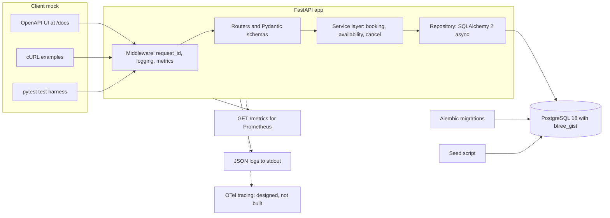
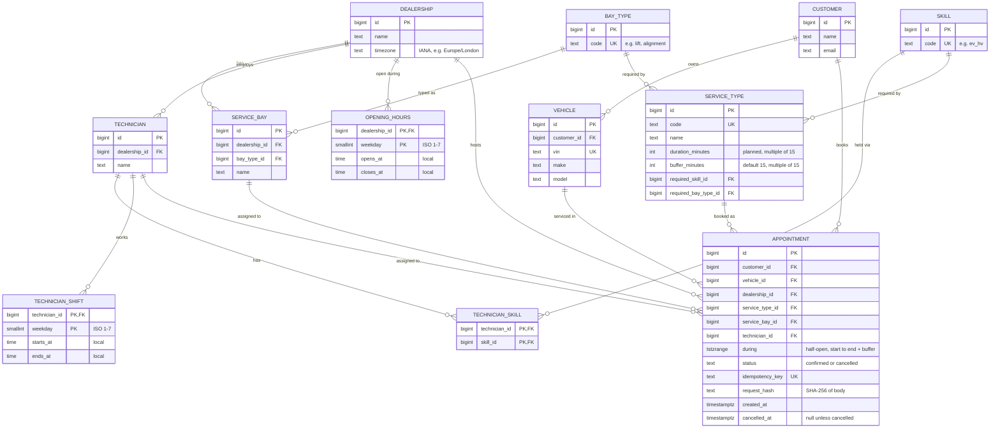
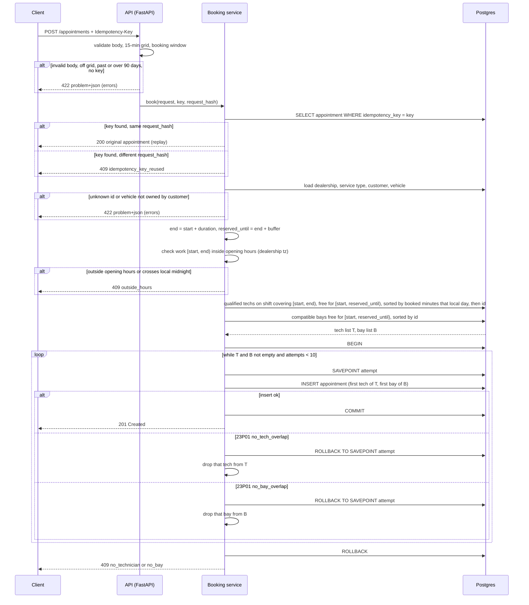

# Unified Service Scheduler: System Design

Status: draft, 2026-11-01. Scenario A (backend implemented, client mocked).

## Key Decisions

- One FastAPI service + one PostgreSQL 18 database; the client is mocked (OpenAPI UI, cURL, tests).
- Double-booking is impossible: two Postgres `EXCLUDE` constraints reject any overlap for the same bay or technician, even with many API servers.
- The system picks the bay and technician: least-loaded qualified tech, lowest-id bay.
- A booking reserves planned work time + a 15-min buffer; overruns are handled by the advisor.
- `Idempotency-Key` makes client retries safe; cancel frees the slot.
- Build order: core, idempotency, cancel, working hours, availability (last two may slip).
- Observability: JSON logs with `request_id`, Prometheus `/metrics`, `/health` and `/ready`.

## Overview

Service advisors at a dealership book workshop appointments by hand today. This service replaces that with an API. A client asks for a vehicle, a service type, a dealership and a start time. The service checks that a compatible service bay and a qualified technician are both free for the whole service duration. If both are free, it stores a confirmed appointment that links the customer, vehicle, technician and bay.

The brief's three core requirements map to the design like this:

| Brief requirement | Where it is handled |
|---|---|
| 1. Resource constrained booking | `POST /appointments` with vehicle, service type, dealership and start time |
| 2. Real-time availability check for bay and technician over the whole duration | Booking service picks a candidate pair; two Postgres exclusion constraints reject any overlap at insert time |
| 3. Confirmed appointment record | `appointment` table row linking customer, vehicle, technician and service bay |

Scope:

- Implemented: the backend. A REST API (FastAPI) on PostgreSQL, with booking, idempotent retries, cancel, health checks and metrics. Working hours and the availability query are built after those, in that order. If one of them is not built by the deadline, this document marks it "designed, not built".
- Mocked: the client. The generated OpenAPI UI at `/docs`, cURL examples in the README, and the automated test harness stand in for a front end.
- Reference data (dealerships, bays, technicians, service types, customers, vehicles) is seeded, not managed through the API.

## Assumptions

Each line is a decision taken where the brief is silent.

1. Reference data (dealerships, bays, technicians, skills, service types, customers, vehicles) lives in other Keyloop systems. Here it is seeded by a script; there are no CRUD endpoints for it.
2. The client does not choose the bay or technician. The system assigns both.
3. Technician choice: among qualified technicians on shift, pick the least-loaded one. Ties go to the lowest technician id.
4. Load = sum of booked minutes of active appointments for that technician on that local day. It is read without a lock, so it affects fairness only, never correctness.
5. Bay choice: the compatible bay with the lowest id that is free.
6. If the insert fails because a bay or technician was taken in the meantime (SQLSTATE `23P01`), the service tries the next candidate pair.
7. All timestamps are stored as `timestamptz` in UTC. Each dealership has an IANA time zone (for example `Europe/London`) used for opening hours, shifts and "local day".
8. Start times sit on a 15-minute grid (minute 0, 15, 30 or 45, zero seconds) in UTC.
9. Duration comes from the service type. The client does not send an end time. End = start + duration. This is a planned end, not a measured one (Assumption 24).
10. Each service type requires one bay type (for example `lift`, `alignment`) and one technician skill (for example `ev_hv`). A bay is compatible if its type matches. A technician is qualified if they have the skill.
11. One appointment covers exactly one service type.
12. Dealership opening hours and technician shifts are a weekly pattern: weekday (ISO, 1 = Monday) with a local start and end time, one window per weekday (no split shifts). There are no holidays, closures or one-off exceptions.
13. The work part `[start, end)` must fall inside the dealership's opening hours and inside the assigned technician's shift for that weekday. The buffer (Assumption 24) may run past closing time. An appointment does not cross midnight local time.
14. Booking window: the start must not be in the past and must be at most 90 days ahead.
15. Time ranges are half-open `[start, end)`. An appointment ending at 10:00 does not conflict with one starting at 10:00.
16. The vehicle must belong to the customer in the request.
17. A booking that cannot be placed returns 409 with a `reason`: `no_bay`, `no_technician`, `outside_hours` or `idempotency_key_reused`.
18. Idempotency: `POST /appointments` requires an `Idempotency-Key` header. The key is stored in a UNIQUE `idempotency_key` column with a `request_hash` (SHA-256 of the canonical JSON body).
19. Same key and same body returns 200 with the original appointment. Same key and a different body returns 409 `idempotency_key_reused`.
20. Cancel sets `status = cancelled` and `cancelled_at`; the row is kept. Cancelled rows no longer block the bay or technician. Cancelling an already cancelled appointment returns 200 with the same record.
21. Errors use RFC 9457 `application/problem+json`.
22. Request validation errors return 422. This covers an off-grid start, a start in the past, a start more than 90 days ahead, a vehicle not owned by the customer, unknown reference ids and a missing `Idempotency-Key`.
23. There is no authentication or authorisation in this service. An API gateway in front of it is assumed to handle that.
24. Nobody knows in advance how long a real repair takes. Workshops book against a planned duration: a standard labour time per job. So `duration_minutes` is planned time, and each service type also has `buffer_minutes` (default 15, a multiple of 15) as slack for small overruns. The bay and technician are reserved for `[start, start + duration + buffer)`. This range is what `during` stores and what the overlap rules check. The API returns both `end` (planned end of work) and `reserved_until` (end of the buffer).
25. The system stores the plan only. If a job overruns past its buffer, nothing moves automatically. The service advisor (the person who manages bookings at the front desk) tells the next customer, or cancels and rebooks. See "Operational delays" in Data Flow.
26. Jobs that can last several days are out of scope. That covers repairs that start with fault diagnosis, jobs waiting for parts, and body repair. Every appointment here is one known service type with a planned duration inside one working day.

## Architecture



| Component | Role |
|---|---|
| Client mock | The OpenAPI UI at `/docs`, cURL examples in the README and the pytest harness. They send the same HTTP requests a front end would. |
| Middleware | Reads or creates the `request_id`, writes one JSON log line per request, and records HTTP metrics. |
| Routers and schemas | Map HTTP to service calls. Pydantic models validate the body, the 15-minute grid and the booking window, and return 422 on failure. They also turn service errors into `problem+json`. |
| Service layer | Business rules. Booking: ownership check, end time, opening hours and shift checks, candidate ranking, the `SAVEPOINT` insert loop and the reason choice. Availability: slot generation for one local date. Cancel: the status update. No HTTP types here, so the rules can be unit tested. |
| Repository | All SQL, through SQLAlchemy 2 async with asyncpg. Runs the candidate queries and the insert, and maps SQLSTATE `23P01` (with the constraint name) and `23505` to typed errors for the service layer. |
| PostgreSQL 18 | Stores all data. The exclusion constraints `no_bay_overlap` and `no_tech_overlap` and the UNIQUE `idempotency_key` are the final check against double-booking and duplicate requests. |
| Alembic migrations | Create the schema, the `btree_gist` extension and both exclusion constraints. Run before the API starts. |
| Seed script | Loads the reference data (Assumption 1): dealerships, bays, technicians, skills, shifts, opening hours, service types, customers and vehicles. |
| Observability outputs | `/metrics` in Prometheus text format, and JSON logs on stdout. OTel tracing is designed but not built (see Observability). |

Deployment. `docker compose` runs two services: `api` (the FastAPI app under uvicorn) and `postgres` (the `postgres:18` image with a named volume). Migrations run before the API starts. The seed script is a separate command. The API keeps no state between requests. Everything lives in Postgres, so more API containers can be added without code changes (see Scalability, Performance and Reliability).

## Data Model



Seed service types. Durations are illustrative, in the style of standard labour times, not real figures from a manufacturer. The set covers one shared bay type (`lift`), two special bays (`alignment`, `mot_lane`) for the `no_bay` case, and rare skills for the `no_technician` case.

| Service type | Duration | Buffer | Bay type | Skill |
|---|---|---|---|---|
| Oil and filter change | 45 min | 15 min | `lift` | `general` |
| Full annual service | 180 min | 15 min | `lift` | `general` |
| Brake pads replacement | 90 min | 15 min | `lift` | `general` |
| Wheel alignment | 60 min | 15 min | `alignment` | `alignment` |
| MOT test (UK yearly road-safety test) | 60 min | 15 min | `mot_lane` | `mot_tester` |
| EV battery health check | 60 min | 15 min | `lift` | `ev_hv` |

The rule against double-booking lives in the database, not in application code:

```sql
CREATE EXTENSION IF NOT EXISTS btree_gist;  -- lets gist index a plain bigint with =

ALTER TABLE appointment
  ADD CONSTRAINT no_bay_overlap
  EXCLUDE USING gist (service_bay_id WITH =, during WITH &&)
  WHERE (status <> 'cancelled');

ALTER TABLE appointment
  ADD CONSTRAINT no_tech_overlap
  EXCLUDE USING gist (technician_id WITH =, during WITH &&)
  WHERE (status <> 'cancelled');
```

An insert that overlaps an active appointment on the same bay or technician fails with SQLSTATE `23P01`, and the error names the constraint, so the service knows which resource clashed. The booking service checks that the vehicle belongs to the customer before the insert. A composite foreign key `(vehicle_id, customer_id)` could enforce this in the database. It is not used because a vehicle can change owner later, and a past appointment must keep the customer who booked it.

## API

The OpenAPI UI served at `/docs` is the mocked client. It lists every endpoint with its schema and lets a reviewer send requests from the browser.

| Method | Path | Purpose | Success codes |
|---|---|---|---|
| POST | `/appointments` | Book an appointment; system assigns bay and technician | 201 created, 200 idempotent replay |
| GET | `/appointments/{id}` | Read one appointment | 200 |
| POST | `/appointments/{id}/cancel` | Cancel; frees the bay and technician | 200 |
| GET | `/availability` | Free start times for one service type at one dealership on one local date | 200 |
| GET | `/health` | Liveness: the process is up | 200 |
| GET | `/ready` | Readiness: the database answers | 200 (503 if not) |
| GET | `/metrics` | Prometheus metrics | 200 |

`GET /availability` query parameters:

- `dealership_id`: the dealership.
- `service_type_id`: decides duration, bay type and skill.
- `date`: a local date in the dealership's time zone, for example `2026-11-10`.

The response lists the 15-minute start times on that date where at least one qualified technician and one compatible bay are free for the whole duration. It is advisory. The booking insert is the final check.

Booking request:

```http
POST /appointments
Content-Type: application/json
Idempotency-Key: 6f1c2a0e-8b7d-4c1e-9a55-2d3f4e5a6b7c

{
  "customer_id": 42,
  "vehicle_id": 314,
  "dealership_id": 1,
  "service_type_id": 3,
  "start": "2026-11-10T09:00:00Z"
}
```

Response `201 Created`:

```json
{
  "id": 1001,
  "customer_id": 42,
  "vehicle_id": 314,
  "dealership_id": 1,
  "service_type_id": 3,
  "bay": { "id": 7, "name": "Bay 2" },
  "technician": { "id": 12, "name": "Minh Tran" },
  "start": "2026-11-10T09:00:00Z",
  "end": "2026-11-10T10:30:00Z",
  "reserved_until": "2026-11-10T10:45:00Z",
  "status": "confirmed",
  "created_at": "2026-11-01T08:15:02Z"
}
```

Sending the same request again with the same `Idempotency-Key` returns `200 OK` with this same body. No second appointment is created.

Response `409 Conflict` when no qualified technician is free:

```http
HTTP/1.1 409 Conflict
Content-Type: application/problem+json

{
  "type": "https://example.com/problems/booking-conflict",
  "title": "Appointment cannot be booked",
  "status": 409,
  "detail": "No technician with skill ev_hv is free from 09:00 to 10:30 UTC on 2026-11-10.",
  "instance": "/appointments",
  "reason": "no_technician",
  "request_id": "b7e4c1d2a9f0"
}
```

Status codes:

- `201 Created`: appointment booked.
- `200 OK`: idempotent replay of a booking, a read, a cancel, or an availability result.
- `404 Not Found`: appointment id does not exist.
- `409 Conflict`: the request is valid but cannot be placed. `reason` is one of `no_bay`, `no_technician`, `outside_hours`, `idempotency_key_reused`.
- `422 Unprocessable Content`: validation failed. Examples: start not on the 15-minute grid, start in the past, start more than 90 days ahead, vehicle not owned by the customer, unknown reference id, missing `Idempotency-Key`. The problem body lists the failing fields in `errors`.
- `503 Service Unavailable`: `/ready` when the database cannot be reached, or any request whose query hits the database `statement_timeout` (see Scalability, Performance and Reliability).

All error bodies use RFC 9457 `application/problem+json` with `type`, `title`, `status`, `detail`, `instance`, plus `reason` for 409 and `request_id` for tracing.

## Data Flow

This is the path of `POST /appointments`. Steps run in one database transaction, except the read-only checks before it.



Notes on the loop:

- Why a savepoint. In Postgres, any error inside a transaction aborts the whole transaction. Every later statement fails until a rollback. So each insert attempt runs under its own `SAVEPOINT`. A failed attempt rolls back to that savepoint and the transaction stays usable. Running each attempt in its own short transaction would also work.
- Pre-filter. The two candidate queries already exclude any tech or bay with an active appointment where `during && tstzrange(start, reserved_until, '[)')`. So in normal use the first insert succeeds. A `23P01` only happens on a real race: another request booked the same tech or bay between our read and our insert.
- The constraint name in the `23P01` error tells the service which resource clashed. It drops only that tech or that bay and keeps the other.
- Retry bound. Each failed attempt removes one tech or one bay, so no pair is tried twice. The loop also stops after 10 attempts. Then the service returns 409.
- Reason when no pair succeeds. If the tech list is empty, the reason is `no_technician`, even if the bays are also full. Otherwise the reason is `no_bay`. This order is an assumption: a qualified technician is usually harder to find than a free bay, so it is the more useful thing to tell the advisor. If the 10-attempt cap ends the loop with both lists non-empty, the reason names the resource of the last `23P01`.

Cancel flow (`POST /appointments/{id}/cancel`): the service runs `UPDATE appointment SET status = 'cancelled', cancelled_at = now() WHERE id = :id AND status = 'confirmed'`. The exclusion constraints have `WHERE (status <> 'cancelled')`, so the row stops counting at once and the bay and technician are free for new bookings. If the row is already cancelled, the update touches nothing and the service returns 200 with the stored record. An unknown id returns 404.

Operational delays (Assumptions 24 and 25). A booking is a plan. When a job runs late, the next appointment for that bay or technician keeps its time:

```
Tech 1 plan: [ Brake pads 09:00-10:30 | buffer to 10:45 ][ Oil change 10:45-11:30 ]
real:        [ Brake pads 09:00 ------------- 11:00 ]
                                                ^ oil change starts 15 min late
```

The buffer absorbs small overruns. A larger overrun is handled by the service advisor: they tell the customer, or cancel and rebook. The system never pushes later appointments by itself. Each customer was promised a time. A push spreads, because a moved job can collide with another bay or technician and push more jobs. It would also need customer notifications, which are out of scope. Two later steps would help, and both are future work:
- a reassign endpoint that moves a waiting appointment to another free technician or bay at the same time, using the same booking logic;
- recording actual start and finish times, so overruns can be measured and the planned durations tuned.

## Concurrency and Correctness

The core rule is "no bay and no technician is in two active appointments at the same time". The two GiST exclusion constraints `no_bay_overlap` and `no_tech_overlap` (see Data Model) enforce it. They are the source of truth for both the bay and the technician. Everything in the application, including `GET /availability` and the candidate queries, is advisory.

Why a database constraint and not application locks or `SELECT ... FOR UPDATE`:

- It holds across any number of API instances. An in-process lock only covers one process. A distributed lock adds a new component that can fail.
- `SELECT ... FOR UPDATE` can only lock rows that exist. A free time slot has no row to lock, so two requests can both see "free" and both insert. Locking the bay and technician rows instead works, but every code path must take the locks in the same order or it can deadlock.
- A bug in application code cannot double-book. The worst a bug can do is pick a bad candidate, and the insert then fails.
- Under concurrency, Postgres makes a second insert that overlaps an uncommitted one wait. If the first commits, the second fails with `23P01`. If the first rolls back, the second succeeds. No extra code is needed for this. This is documented Postgres behaviour, not yet run here; the concurrency test in Testing Strategy checks it.

Half-open ranges. `during` is built with `tstzrange(start, reserved_until, '[)')`. A reserved range ending at 10:00 and one starting at 10:00 do not overlap, so back-to-back bookings in the same bay are allowed once the buffer has passed (Assumptions 15 and 24).

Cancelled rows. Both constraints are partial: `WHERE (status <> 'cancelled')`. A cancelled row stays in the table for history but is ignored by the overlap check. No delete is needed to free a slot.

Idempotency race. Two requests with the same `Idempotency-Key` can arrive at once. Both find no row in the lookup and both try to insert. The `idempotency_key` UNIQUE index makes the second insert wait for the first. When the first commits, the second fails with SQLSTATE `23505`. This holds on every attempt of the loop, because each attempt inserts the same key, so a retry on another pair cannot slip a duplicate past it. On `23505` the service rolls back, reads the existing row, and compares `request_hash`. Same hash returns 200 with that row. A different hash returns 409 `idempotency_key_reused`.

Load read. The "booked minutes that local day" used to rank technicians is read without a lock. Two concurrent requests may both pick the same least-loaded technician. This only affects how evenly work is spread. It cannot cause a double-booking, because the insert is still checked by `no_tech_overlap` (Assumption 4).

Checked against Postgres. A test run on the `postgres:18` Docker image with `btree_gist` and the two constraints gave these results:

| Case | Result |
|---|---|
| First booking: bay 1, technician 1, `[10:00, 11:30)` | inserted |
| Same bay and technician, touching range `[11:30, 12:00)` | inserted |
| Same bay and technician, overlapping `[10:15, 10:45)`, status `cancelled` | inserted |
| Technician 1 in bay 2, overlapping `[10:15, 10:45)` | rejected, SQLSTATE `23P01`, error names `no_tech_overlap` |

All times are UTC on 2026-11-03.

The last case matters most. It shows that the technician check is independent of the bay, and that the constraint name tells the service which resource clashed.

## Availability Algorithm

`GET /availability` answers: "at which start times on this local date can this service type be booked at this dealership?"

Input: `dealership_id`, `service_type_id`, `date` (local date in the dealership's time zone).

Steps:

1. Load the service type: duration, required bay type, required skill.
2. Find the opening window for the date's ISO weekday. No row for that weekday means the dealership is closed and the result is an empty list.
3. Convert the local window to UTC with the dealership's IANA time zone using Python `zoneinfo`. The conversion is done for that exact date, so a DST change (for example the last Sunday of October in `Europe/London`) gives the right UTC times. Local midnight to the next local midnight gives the UTC range of the day.
4. Generate candidate starts on the 15-minute UTC grid (Assumption 8) where `start >= opens_at` and `start + duration <= closes_at` (the buffer may run past closing, Assumption 13). Drop starts in the past or more than 90 days ahead (Assumption 14).
5. In one query, load the active appointments that overlap the day for the dealership's compatible bays and qualified technicians. In the same round trip, load the shifts of those technicians for that weekday.
6. In memory, a start `s` is free if both hold:
   - some qualified technician has a shift that covers `[s, s + duration)` and no active appointment that overlaps `[s, s + duration + buffer)`, and
   - some compatible bay has no active appointment that overlaps `[s, s + duration + buffer)`.
7. Return the free starts in time order.

Cost. One or two queries per request, then `O(slots x (techs + bays))` checks in memory, where each check scans that resource's appointments for the day. A 10-hour day has 40 slots. With 20 resources and a handful of appointments each, that is a few thousand comparisons. This is small enough that no cache is needed.

The result is advisory. Another request can take a slot between the availability call and the booking. The booking insert and its exclusion constraints make the final decision, and the client gets a 409 with a `reason` if the slot is gone.

## Technology Choices

Versions are the ones installed and imported on Python 3.14 on 2026-11-01.

| Technology | Why | Alternative considered |
|---|---|---|
| Python 3.14 | Python is my strongest language, so I can write and review the code fastest and catch AI mistakes in it. `zoneinfo` in the standard library handles IANA time zones and DST. | TypeScript with Node (NestJS). Also a strong language for me. Python won on its Postgres tooling (SQLAlchemy range and exclusion types) and on `zoneinfo` in the standard library. |
| FastAPI 0.162 | Generates the OpenAPI spec and the `/docs` UI from the code, and that UI is the mocked client. Async request handling fits an API that mostly waits on the database. Dependency injection makes it easy to swap the database session in tests. | Django REST Framework. I know Django well, and `django.contrib.postgres` has range fields and `ExclusionConstraint`, so it would work. It was not chosen because its ORM is sync-first and the admin, auth and templates are not needed here. |
| Pydantic 2.14 | Request and response schemas with validation, used by FastAPI. Custom validators cover the 15-minute grid and the 90-day window. | Hand-written checks in the routers. More code, and the rules would not show in the OpenAPI spec. |
| SQLAlchemy 2.1 async + asyncpg 0.32 | SQLAlchemy has the PostgreSQL types needed here (`TSTZRANGE`, `ExcludeConstraint`) and nested transactions for the `SAVEPOINT` loop. asyncpg is the async driver it supports for Postgres and exposes the SQLSTATE and constraint name of an error. | Raw SQL with asyncpg only. Less abstraction, but more boilerplate for mapping rows. psycopg 3 also works on 3.14 and is a fine driver; asyncpg was chosen as the common pairing for async SQLAlchemy. |
| Alembic 1.20 | Versioned migrations for SQLAlchemy models. The exclusion constraints and the extension go in a migration, so every environment and every test database gets the same schema. | `metadata.create_all()`. No history, and no clean way to change the schema later. |
| PostgreSQL 18 + `btree_gist` | `tstzrange` and `EXCLUDE USING gist` make "no overlap" a database rule (see Concurrency and Correctness). `btree_gist` lets the GiST index compare plain `bigint` ids with `=`. Checked on the `postgres:18` image. | MySQL or SQLite. Neither has exclusion constraints, so the overlap rule would need locks in the application. |
| structlog 26.1 | JSON log lines with bound context, so `request_id` is added once per request and shows on every line. | The standard `logging` module with a JSON formatter. Works, but binding per-request context takes more code. |
| prometheus-client 0.26 | The standard Python client for Prometheus counters and histograms, served at `/metrics`. | OTel metrics. Possible, but Prometheus scraping needs no collector to run locally. |
| OpenTelemetry (designed, not built) | Would trace each request and its database queries. Not built: with one service and one database, logs with `request_id` and `latency_ms` plus latency metrics answer "which request was slow", and a trace viewer would add a component to run. The packages were install-checked on Python 3.14 (`opentelemetry-instrumentation-fastapi` and `-sqlalchemy` 0.66b2, `opentelemetry-exporter-otlp` 1.45.2), so adding it later is a small step. | Build it now. Rejected: 3 more packages, two of them beta, and nothing visible in the demo without a trace viewer. |
| pytest 9.1 + testcontainers 4.15 + httpx 0.28 | pytest runs all tests. testcontainers starts a real `postgres:18` container for the test session, because the core rule lives in Postgres. httpx `AsyncClient` calls the app in process for API tests. | SQLite in memory. Fast, but it cannot run exclusion constraints, so it would not test the core rule. A shared compose database for tests was also possible, but testcontainers gives each run a clean database. |
| uv | One tool for the Python version, the virtual env, dependency locking and running commands. Fast installs in Docker and CI. | pip with venv, or Poetry. Both work; uv is faster and puts the Python version, the lock file and the commands in one tool. |
| Docker compose | One command starts the API and Postgres for a reviewer. Same Postgres image as the tests. | Running Postgres on the host. Harder to reproduce on another machine. |

## Observability

Two signals are built: logs and metrics. Logs carry the `request_id`. Traces are designed but not built (see Traces below).

Request id. The middleware reads the `X-Request-ID` header. If it is missing, it creates a new random id. The id is bound to the log context for the request, returned in the `X-Request-ID` response header, and put in the `request_id` field of every problem body (see API). A client or support person can quote it and find every log line of that request.

Logs. structlog writes one JSON object per line to stdout. The container platform collects stdout, so the app does not manage log files. Each request ends with one access line. Booking adds one line with its outcome.

| Field | Meaning |
|---|---|
| `ts` | UTC timestamp, ISO 8601 |
| `level` | `info`, `warning` or `error` |
| `request_id` | from `X-Request-ID` or generated |
| `method` | HTTP method |
| `route` | route template, for example `/appointments/{id}`, not the raw path |
| `status` | HTTP status code |
| `latency_ms` | time spent in the app for this request |
| `appointment_id` | set when a booking or cancel touches an appointment |
| `reason` | set on a 409: `no_bay`, `no_technician`, `outside_hours`, `idempotency_key_reused` |
| `attempts` | number of insert attempts in the booking loop (1 to 10) |

Request bodies are not logged, so customer names and emails stay out of the logs.

Metrics. Served at `GET /metrics` in Prometheus text format: request latency per route, bookings made, bookings rejected by reason, insert attempts per booking (contention), and cancels. The full table is in Appendix A.

Label cardinality. Labels only take values from a small, fixed set: route templates, methods, status codes, reasons and dealership ids. Customer ids, vehicle ids, appointment ids, idempotency keys and request ids are never labels. Each new label value creates a new time series in Prometheus, so an unbounded id would grow memory without limit. Those ids belong in logs.

Traces (designed, not built). OpenTelemetry would instrument FastAPI (one span per request) and SQLAlchemy (one child span per query), so a slow booking would show whether the time went to the candidate queries, the insert loop or a wait on another transaction. Spans would go over OTLP to a viewer such as Jaeger, switched on by `OTEL_EXPORTER_OTLP_ENDPOINT`. It is not built because this system has one service and one database: the `request_id` in logs, `latency_ms` and the latency histogram already find a slow request. Tracing pays off once a request crosses several services.

Health checks.

- `GET /health` is liveness. It returns 200 if the process can answer. It does not touch the database, so a database outage does not make the orchestrator restart healthy API containers.
- `GET /ready` is readiness. It runs `SELECT 1` on the pool. It returns 503 if that fails, so a load balancer stops sending traffic to that instance.

Example alerts. Four example Prometheus alert rules (rejection rate by reason, slow bookings, contention, instance not ready) are in Appendix A. No alerting stack is part of this build.

## Scalability, Performance and Reliability

This section separates what is built from what is future work.

Built:

- Stateless API. An API instance keeps no state between requests. Bookings, idempotency keys and cancels all live in Postgres. More instances can run behind a load balancer. Each container runs one uvicorn worker, so the in-process Prometheus registry is correct; to scale, add containers, not workers.
- Correctness at N instances. The rule against double-booking is the two exclusion constraints and the UNIQUE `idempotency_key`. They hold no matter how many API instances insert at once, because Postgres checks every insert against all committed and in-progress rows. No lock in the application is needed (see Concurrency and Correctness).
- Indexes for overlap queries. Each exclusion constraint creates a GiST index on `(service_bay_id, during)` or `(technician_id, during)`. The candidate queries and the availability query filter on the same columns with `=` and `&&`, so they can use these indexes and do not scan the whole table.
- Small query count. A booking runs a fixed number of reads, then usually one insert. Availability runs one or two queries per request (see Availability Algorithm). There is no N+1 pattern.
- Connection pool. SQLAlchemy keeps a pool of connections per instance. Its defaults are `pool_size=5` and `max_overflow=10`, so one instance can open up to 15 connections. The rule to keep is: instances x (pool_size + max_overflow) below Postgres `max_connections` (100 by default), with room for migrations and admin access. The values come from settings, not code.
- Timeouts. A database `statement_timeout` (planned default: 5 seconds) bounds any query, including an insert that waits on another transaction for the same bay or technician. A request that hits it returns 503 and does not hold a connection forever.
- Safe client retries. A client that times out does not know if its booking was stored. It sends the same request again with the same `Idempotency-Key`. It gets the original appointment back with 200, or the booking is made now. It never gets two appointments (Assumptions 18 and 19).
- Readiness. `/ready` lets a load balancer route around an instance that has lost the database (see Observability).

Maintainability (built):

- Layers with one job each: routers and schemas (HTTP), service layer (business rules), repository (SQL). The business rules use no HTTP or database types, so they can change and be unit tested on their own (see Architecture).
- The schema changes only through Alembic migrations, so every environment and test database has the same schema and its history.
- The OpenAPI spec is generated from the code, so the API contract cannot drift from the implementation.
- Configuration (database URL, pool size, timeouts) comes from environment settings, not code.
- The test suite in Testing Strategy covers every business rule, so a change that breaks one fails a test.

Future, not built:

- The database is the single point of failure. In production it would be a managed Postgres service with a standby and automatic failover. The app would only need a new connection string.
- Read replica for availability. `GET /availability` is read-only and advisory, so it could read from a replica. A replica can lag behind, but the booking insert on the primary is still the final check, so lag only means a slightly stale list. Bookings must stay on the primary.
- Partitioning by dealership. All queries filter by one dealership. If the `appointment` table grows large, it could be partitioned by `dealership_id`, or dealerships could be split across databases. Each exclusion constraint then needs to include the partition key, which is fine here because a bay or technician belongs to one dealership. Not needed at the expected size of one dealership group.
- Caching. Not planned. Availability changes with every booking, and the query is cheap (see Availability Algorithm).

## Testing Strategy

The core rule lives in Postgres, so most tests that matter run against a real Postgres. Pure rules that need no database are unit tested.

Unit tests (no database, fast):

- End time: `end` = start + `duration_minutes`, `reserved_until` = `end` + `buffer_minutes`, and the half-open range `[start, reserved_until)`.
- Buffer near closing: a job whose work ends exactly at closing time is accepted even though its buffer runs past it.
- Request validation: a start off the 15-minute grid, with seconds, in the past, or more than 90 days ahead is rejected with 422. The clock is injected, so tests do not depend on today's date.
- Slot generation for one local date: the first and last start inside opening hours, a service longer than the window gives no slots, and a closed weekday gives an empty list.
- DST: slot generation in `Europe/London` on 2026-10-25, the day clocks go back. Opening at 08:00 local is 07:00 UTC on 2026-10-24 and 08:00 UTC on 2026-10-25. The test checks the UTC starts of both days. The clock is fixed to a date before them, so the past-start rule does not drop the slots.
- Reason precedence: empty tech list gives `no_technician` even when bays are also empty. Empty bay list only gives `no_bay`. Cap reached with both lists non-empty gives the resource of the last `23P01`.

Integration tests on real Postgres (testcontainers starts `postgres:18`; Alembic builds the schema; each test runs in a clean state):

- Bay overlap: a second booking that overlaps in the same bay with a different technician fails with `no_bay_overlap`.
- Technician overlap: a second booking for the same technician in a different bay fails with `no_tech_overlap`.
- Touching ranges: `[10:00, 11:30)` and `[11:30, 12:00)` on the same bay and technician both succeed.
- Buffer blocks: after a 90-min job at 09:00 (reserved until 10:45), a booking for the same technician at 10:30 is refused and one at 10:45 succeeds.
- Cancel frees the slot: book, cancel, then book the same slot again and get 201. Cancelling twice returns 200 with the same record.
- Idempotent replay: the same key and body returns 200 with the same appointment id, and the table still has one row. The same key with a different body returns 409 `idempotency_key_reused`.
- Least-loaded pick: with two qualified technicians and one already booked for 2 hours that day, the booking goes to the other one. With equal load, it goes to the lower id.
- `outside_hours`: a booking that starts before opening or ends after closing returns 409 `outside_hours`.
- Shifts: a booking inside opening hours but outside every qualified technician's shift returns 409 `no_technician`.
- Vehicle ownership: a vehicle that belongs to another customer returns 422.

Concurrency tests (real Postgres, real parallel connections):

- One slot, capacity k. Seed k qualified technicians and k compatible bays. Send N > k bookings for the same start at the same time with `asyncio.gather`, each with its own key and its own connection. Expect exactly k responses of 201 and N - k of 409. Then query the table and check that no two active rows share a bay or a technician with overlapping `during`.
- Same key twice at once. Send two identical requests with the same `Idempotency-Key` in parallel. Expect one 201 and one 200 with the same appointment id, and exactly one row. This test and the one above check the Postgres wait behaviour described in Concurrency and Correctness, which is documented but not yet run in this project.

API tests (httpx `AsyncClient` against the app in process, on the same test database):

- Status codes and `problem+json` bodies for 201, 200, 404, 409 and 422, including `reason` and `request_id`.
- `X-Request-ID` is echoed back when sent and generated when missing.
- `/health` returns 200, `/ready` returns 200 with the database up, and `/metrics` lists the metric names from Appendix A.

Why not SQLite. SQLite has no range types and no exclusion constraints. Tests on SQLite would skip the one rule that prevents double-booking, so they would pass while the real system could fail.

Coverage. The aim is full branch coverage of the booking and availability modules, since that is where the business rules are. Routers, settings and the seed script are covered by the API tests, with no target number.

## How GenAI Helped in the Design

I used Claude Code (Opus 5.5) for this design. The full record of asks, outputs and checks is in [ai-log.md](ai-log.md).

How I worked with the AI:

- Plan first. The AI asked me multiple-choice questions, each option with its trade-off. It wrote `research.md` and `plan.md` outside the repo and built nothing until I approved the plan.
- The build was split into tasks. A separate subagent drafted each section of this document. The orchestrating AI read every draft against the plan and fixed it before my review.
- Each subagent listed every assumption it added on its own, so I can accept or change each one. My review of those lists is still pending.

What I decided and what the AI proposed:

- I chose FastAPI + PostgreSQL, a database exclusion constraint against overlaps, and assignment of bay and technician by the system.
- For the pick rule, the AI offered three options. One was a pluggable strategy interface, which the AI itself flagged as YAGNI. I rejected it and chose the least-loaded technician that day, then the lowest-id bay.
- I asked for all four extras. The AI pushed back: working hours and the availability query are about half the build effort, and tests, docs and the video are also graded. We agreed a build order: idempotency, cancel, working hours, availability.
- The AI added two assumptions I had not asked for, a 90-day booking window and RFC 9457 errors, and flagged both. I kept both.

How claims were checked:

- The AI ran the exclusion constraint on a real `postgres:18` container with four inserts instead of trusting memory. The results are in Concurrency and Correctness. I read the output.
- The AI installed the planned libraries on Python 3.14 and imported them, in two rounds. The second round covered `opentelemetry-instrumentation-sqlalchemy` 0.66b2, `opentelemetry-exporter-otlp` 1.45.2 and `httpx` 0.28.1, after a draft admitted they were unchecked.

What went wrong, and who caught it.

Caught by me, while reading the draft:

- The draft assumed every service has a known end time. I asked three questions. How can a repair have an end time when nobody can measure it in advance? What about cars that stay in the workshop for several days? If a job overruns, what happens to the next appointment, and do delays push all later bookings? None of this was in the draft. The AI then explained how workshops plan with standard labour times. It proposed four ways to handle overruns: manual handling, a buffer, a reassign endpoint, and an automatic push. I chose manual handling plus a buffer. This added Assumptions 24 to 26, the `buffer_minutes` column, the seed service types and the "Operational delays" part of Data Flow.

Caught by the orchestrating AI, in subagent drafts:

- The first ai-log described my asks wrongly and credited me with a check the AI ran. It was rewritten.
- Data Model said a constraint "cannot express" vehicle ownership. That is false: a composite foreign key can. The real reason is that ownership changes over time.
- The Postgres check table used made-up times. They were replaced by the times actually run.
- Postgres's wait on an overlapping uncommitted insert was stated as fact with no test behind it. It is now marked as documented but not yet run, and a concurrency test was added to cover it.
- Technology Choices put untrue claims in my mouth ("uv daily", "less backend time in TypeScript"). They were removed.
- A test expected `outside_hours` for a shift miss while Data Flow gives `no_technician`. The test was fixed.

The rule I followed: the AI proposes, I choose, a run or a test confirms.

What I would do differently, and the limits:

- An AI reviewing AI catches a lot, but not everything. My own read of this document is the last check, and it is still pending.
- Some claims are still documented, not run, such as the Postgres wait behaviour. They stay marked that way until a test covers them.

## Out of Scope and Future Work

- CRUD endpoints for reference data (dealerships, bays, technicians, service types, customers, vehicles). It is seeded (Assumption 1).
- Rescheduling. It would be cancel + book in one transaction, so the old slot is only freed if the new one is booked.
- Notifications to the customer or the advisor.
- Authentication and authorisation. An API gateway in front of the service is assumed to handle them (Assumption 23).
- Holidays, one-off closures and split shifts (Assumption 12).
- Multi-service appointments: one appointment covers one service type (Assumption 11).
- A customer's preferred technician. The system always picks by load (Assumption 3).
- Jobs over several days, fault diagnosis, waiting for parts (Assumption 26).
- Automatic push of later appointments when a job overruns, a reassign endpoint, and recording actual start and finish times (see "Operational delays" in Data Flow).
- Read replica for availability, managed Postgres with failover, and partitioning by dealership. See Scalability, Performance and Reliability.
- An alerting stack. Only example rules are written (see Appendix A).
- Distributed tracing with OpenTelemetry (see Traces in Observability).

Working hours and the availability query are steps 3 and 4 of the build order. If either is not built by the deadline, this document will mark it "designed, not built".

## Appendix A: Observability Detail

Metrics:

| Metric | Type | Labels | What it shows |
|---|---|---|---|
| `http_request_duration_seconds` | histogram | `route`, `method`, `status` | request rate, error rate and latency per endpoint |
| `appointments_booked_total` | counter | `dealership_id` | successful bookings (201 only, not replays) |
| `booking_rejected_total` | counter | `reason` | 409 responses by reason |
| `booking_insert_attempts` | histogram | none | insert attempts per booking; a value above 1 means a race was lost |
| `appointments_cancelled_total` | counter | none | cancels that changed a row |

Example alerts. These are written as rules a Prometheus setup would run. No alerting stack is part of this build.

| Alert | Condition (example) | Why |
|---|---|---|
| Rejection rate by reason | `booking_rejected_total{reason="no_technician"}` above 30% of booking requests over 30 minutes | Dealership is short of qualified staff, or seed data or shifts are wrong. Split by reason tells the two apart from `outside_hours` client errors. |
| Slow bookings | p95 of `http_request_duration_seconds{route="/appointments",method="POST"}` above 500 ms for 10 minutes | Database slow, pool exhausted, or long lock waits. |
| Contention | share of bookings with `booking_insert_attempts` above 1 grows above 5% | Many requests race for the same slots. A sign to look at hot dealerships before users see more 409s. |
| Not ready | `/ready` failing on any instance for 2 minutes | Database unreachable from that instance. |

The thresholds are starting points, not tuned values. They would be set from real traffic.
