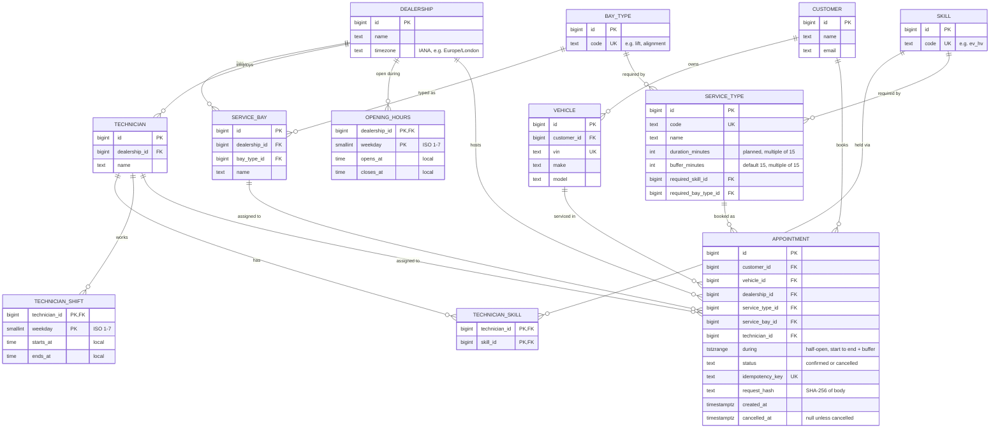

# Data Model

Part of the [system design](../design.md).

## Entities and columns



## Seed service types

Seed service types. Durations are illustrative, in the style of standard labour times, not real figures from a manufacturer. The set covers one shared bay type (`lift`), two special bays (`alignment`, `mot_lane`) for the `no_bay` case, and rare skills for the `no_technician` case.

| Service type | Duration | Buffer | Bay type | Skill |
|---|---|---|---|---|
| Oil and filter change | 45 min | 15 min | `lift` | `general` |
| Full annual service | 180 min | 15 min | `lift` | `general` |
| Brake pads replacement | 90 min | 15 min | `lift` | `general` |
| Wheel alignment | 60 min | 15 min | `alignment` | `alignment` |
| MOT test (UK yearly road-safety test) | 60 min | 15 min | `mot_lane` | `mot_tester` |
| EV battery health check | 60 min | 15 min | `lift` | `ev_hv` |

## Other database guards

```sql
-- the overlap rules depend on status, so a typo like 'canceled' must be impossible
ALTER TABLE appointment
  ADD CONSTRAINT status_valid CHECK (status IN ('confirmed', 'cancelled'));

-- the bay and technician must belong to the appointment's dealership
-- (service_bay and technician each get UNIQUE (id, dealership_id) for this)
ALTER TABLE appointment
  ADD CONSTRAINT bay_in_dealership
  FOREIGN KEY (service_bay_id, dealership_id) REFERENCES service_bay (id, dealership_id);

ALTER TABLE appointment
  ADD CONSTRAINT tech_in_dealership
  FOREIGN KEY (technician_id, dealership_id) REFERENCES technician (id, dealership_id);
```

An insert that overlaps an active appointment on the same bay or technician fails with SQLSTATE `23P01`, and the error names the constraint, so the service knows which resource clashed. The booking service checks that the vehicle belongs to the customer before the insert. A composite foreign key `(vehicle_id, customer_id)` could enforce this in the database. It is not used because a vehicle can change owner later, and a past appointment must keep the customer who booked it.
