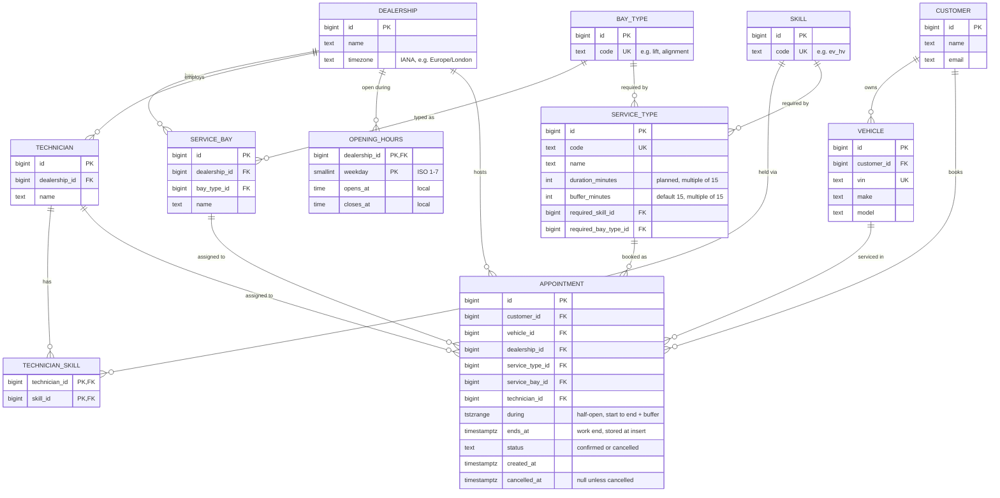

# Data Model

Part of the [system design](../design.md).

## Entities and columns



## Seed service types

Seed service types. Durations are illustrative, in the style of standard labour times, not real figures from a manufacturer. The set covers one shared bay type (`lift`), two special bays (`alignment`, `mot_lane`), and rare skills. Two wheel alignments at once give `no_bay` (two qualified technicians, one bay); two MOT tests or two EV checks at once give `no_technician` (one qualified technician).

| Service type | Duration | Buffer | Bay type | Skill |
|---|---|---|---|---|
| Oil and filter change | 45 min | 15 min | `lift` | `general` |
| Full annual service | 180 min | 15 min | `lift` | `general` |
| Brake pads replacement | 90 min | 15 min | `lift` | `general` |
| Wheel alignment | 60 min | 15 min | `alignment` | `alignment` |
| MOT test (UK yearly road-safety test) | 60 min | 15 min | `mot_lane` | `mot_tester` |
| EV battery health check | 60 min | 15 min | `lift` | `ev_hv` |

## Other database guards

```sql
-- the overlap rules depend on status, so a typo like 'canceled' must be impossible
ALTER TABLE appointment
  ADD CONSTRAINT status_valid CHECK (status IN ('confirmed', 'cancelled'));

-- the bay and technician must belong to the appointment's dealership
-- (service_bay and technician each get UNIQUE (id, dealership_id) for this)
ALTER TABLE appointment
  ADD CONSTRAINT bay_in_dealership
  FOREIGN KEY (service_bay_id, dealership_id) REFERENCES service_bay (id, dealership_id);

ALTER TABLE appointment
  ADD CONSTRAINT tech_in_dealership
  FOREIGN KEY (technician_id, dealership_id) REFERENCES technician (id, dealership_id);

-- the work end lies inside the reserved range (the buffer may be 0)
ALTER TABLE appointment
  ADD CONSTRAINT ends_at_in_during
  CHECK (lower(during) < ends_at AND ends_at <= upper(during));

-- durations sit on the 15-minute grid
ALTER TABLE service_type
  ADD CONSTRAINT duration_valid
  CHECK (duration_minutes > 0 AND duration_minutes % 15 = 0);

ALTER TABLE service_type
  ADD CONSTRAINT buffer_valid
  CHECK (buffer_minutes >= 0 AND buffer_minutes % 15 = 0);

-- ISO weekday, and one window that opens before it closes
ALTER TABLE opening_hours
  ADD CONSTRAINT weekday_valid CHECK (weekday BETWEEN 1 AND 7);

ALTER TABLE opening_hours
  ADD CONSTRAINT hours_valid CHECK (opens_at < closes_at);
```

`ends_at` is the planned end of the work, stored when the appointment is inserted. Editing a service type's duration later never changes old bookings or the load counts used to pick a technician, because both read `ends_at`, not the current service type.

An insert that overlaps an active appointment on the same bay, technician or vehicle fails with SQLSTATE `23P01`, and the error names the constraint, so the service knows which resource clashed. The migration creates `no_vehicle_overlap` first, then `no_tech_overlap`, then `no_bay_overlap`, so a resent request normally fails on the vehicle. The booking service checks that the vehicle belongs to the customer before the insert. A composite foreign key `(vehicle_id, customer_id)` could enforce this in the database. It is not used because a vehicle can change owner later, and a past appointment must keep the customer who booked it.
